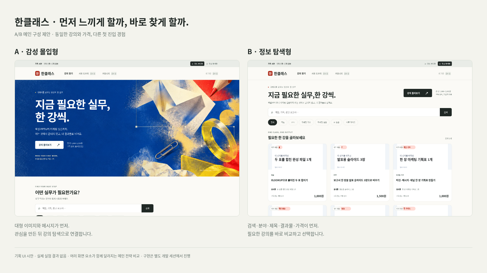
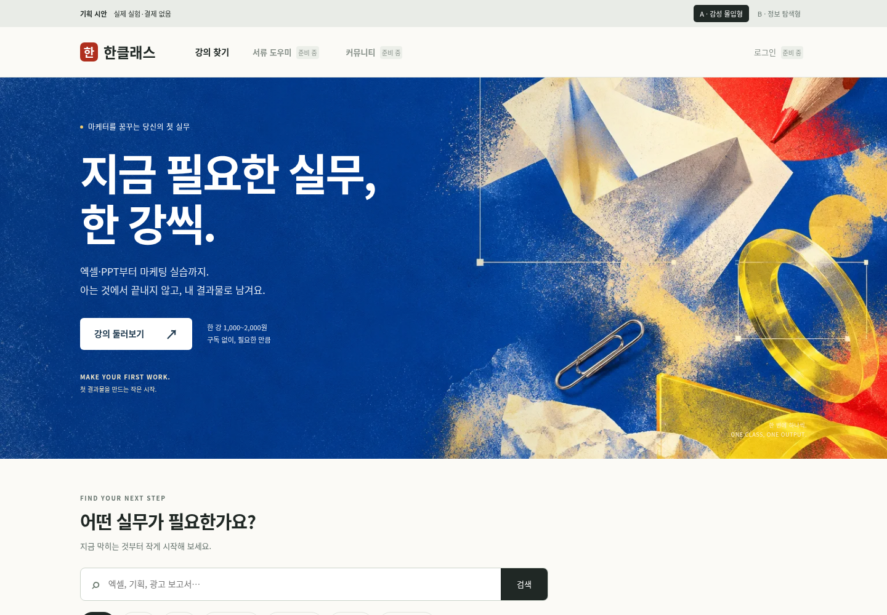
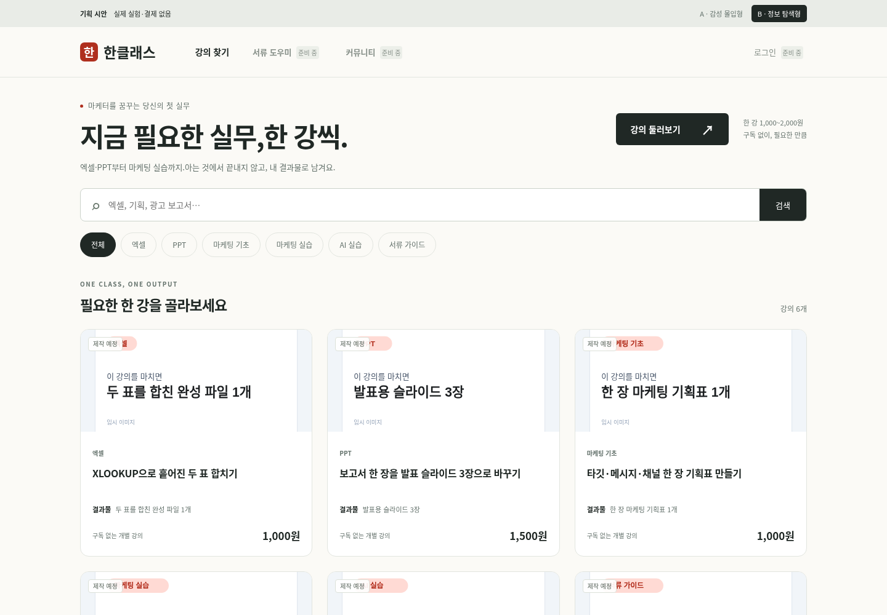

# 한클래스 메인 A/B 시안 v2

별도 기획 브랜치의 자료입니다. 사이트 코드·배포 설정은 변경하지 않았습니다.
실제 실험 결과가 아닌 UI 시안이며, 모든 강의 상태는 시안 제작 시점의 예시입니다.
현재 서비스에서 구현이 완료된 기능은 실제 구현 시 보존하고 임의로 되돌리지 마세요.

## A/B 한눈에 비교

## A안 — 감성 몰입형

큰 이미지와 메시지를 먼저 보여주고, 아래 강의 탐색으로 연결합니다.

## B안 — 정보 탐색형

검색·분야·강의 제목·결과물·가격을 먼저 보여줍니다.

## 모바일

[A안 모바일 보기](A-mobile.png) · [B안 모바일 보기](B-mobile.png)

## 개발 전달 자료

- [기획안 PDF 6쪽](hanklasse-home-ab-plan.pdf)
- [클로드 코드 개발 요청서](claude-development-brief.md)
- [전체 시안 ZIP](hanklasse-home-ab-kit.zip): 내려받아 압축 해제 후 index.html 열기

ZIP에는 배경 원본·웹용 이미지·독립 HTML/CSS/JS 시안·화면 캡처·기획서가 있습니다.
ZIP 파일 화면에서 Download raw file을 누르면 내려받을 수 있습니다.
시안은 검색·전환·구성 확인만 제공하며 실제 무작위 배정·GA4·로그인·결제는 구현하지 않았습니다.

이전 카드 제목/결과물 실험 대신 ‘메인 구성 전략’ 비교를 제안합니다.
큰 이미지·히어로 높이·정보 위치·모바일 카드 밀도가 함께 바뀌므로 이미지 하나의 독립 효과를 주장하지 않습니다.
